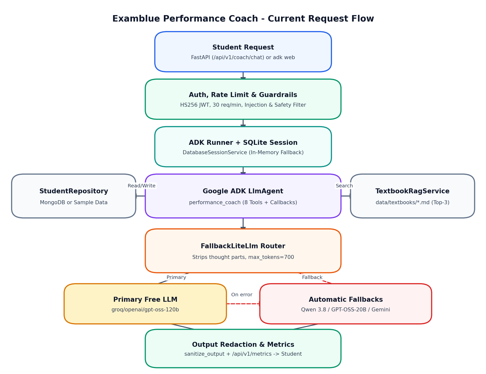
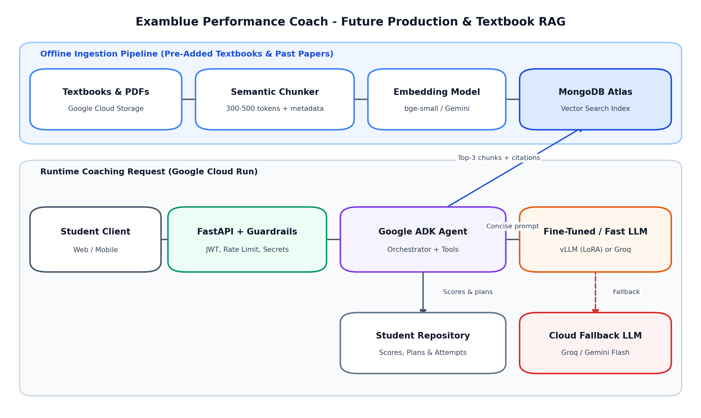

# Coach Agent

Backend service for a student performance coach built with FastAPI, Google ADK, LiteLLM (Groq primary with fallback to secondary Groq/Gemini models), and MongoDB.

## Tech Stack
- **Backend**: Python 3.11, FastAPI (REST + Swagger UI)
- **Agent Framework**: Google ADK (`LlmAgent`, `Runner`, `adk web`)
- **LLM & Fallback**: `FallbackLiteLlm` and `LLMRouter` via LiteLLM (`groq/openai/gpt-oss-120b` -> `groq/qwen/qwen3.8-27b` -> `groq/openai/gpt-oss-20b` -> optional `gemini/gemini-2.5-flash`)
- **Database**: MongoDB (falls back to local sample data when unconfigured)
- **Guardrails**: Input length checks, prompt-injection/unsafe-request filtering, `student_id` validation, secret redaction, and per-client rate limiting
- **Containers**: Docker, Docker Compose

## Commands

### 1. Local Setup
```bash
pip install -r requirements.txt
cp .env.example .env   # PowerShell: Copy-Item .env.example .env
```
Add your `GROQ_API_KEY` (and optionally `GEMINI_API_KEY` and `MONGODB_URI`) to `.env`.

### 2. Run FastAPI Server
```bash
uvicorn app.main:app --reload --port 8000
```
- Swagger UI: `http://127.0.0.1:8000/docs`
- Health check: `http://127.0.0.1:8000/health`

### 3. Run Google ADK Web UI
```bash
adk web app/agents
```
Open the URL printed in the terminal (default `http://127.0.0.1:8000`) and select `performance_coach`.

### 4. Run Tests, Evals & Grade 7 Student Demo
```bash
# Unit and integration tests
pytest -v

# Guardrail & textbook RAG evaluation suite (add --live for live LLM eval)
python -m evals.run_evals

# End-to-end demo for sample Sri Lankan Grade 7 student (lk_g7_kavindu)
python -m scripts.run_student_demo
```

### 5. Run with Docker
```bash
# Start FastAPI (:8000), ADK Web UI (:8001), and MongoDB (:27017)
docker compose up --build

# Or run only the API container
docker build -t examblue-agent .
docker run -p 8000:8000 --env-file .env examblue-agent
```

## API Endpoints (`/api/v1`)
- `GET /health` - Health check
- `GET /api/v1/metrics` - Agent telemetry (chat count, avg latency, LLM calls/fallbacks/errors, guardrail blocks)
- `POST /api/v1/auth/token` - Issue a student-scoped HS256 Bearer token
- `GET /api/v1/students/{student_id}` - Student profile
- `GET /api/v1/students/{student_id}/history` - Exam history
- `GET /api/v1/students/{student_id}/weak-topics` - Weak topics
- `GET /api/v1/students/{student_id}/progress` - Topic averages and trend
- `POST /api/v1/performance/analyze` - Deterministic score analysis
- `POST /api/v1/performance/recommend` - Study recommendations
- `GET /api/v1/questions/by_topic/{topic}` - Practice questions by topic
- `POST /api/v1/questions/evaluate` - Answer evaluation
- `POST /api/v1/coach/chat` - ADK Performance Coach chat (persistent SQLite sessions)

## How It Works
Whether a request comes through FastAPI (`POST /api/v1/coach/chat`) or the Google ADK Web UI (`adk web app/agents`), the agent follows the same pipeline:

1. **Request & Guardrails**: FastAPI validates `student_id`, checks the `Bearer` token (when `AUTH_REQUIRED=true` or a token is sent), applies per-client rate limiting, and runs `check_user_message` to block prompt injections or off-topic/unsafe requests. ADK also runs `before_model_callback` so `adk web` enforces the same checks.
2. **Session Lookup**: ADK loads or creates the student's conversation history in SQLite (`SESSION_DB_URL`), keeping multi-turn context across restarts (with an automatic in-memory fallback if SQLite is unavailable).
3. **Tool-Driven Reasoning**: `LlmAgent` (`performance_coach`) decides which tools to call before answering:
   - *Read*: `get_exam_history_tool`, `get_weak_topics_tool`, `generate_recommendations_tool`, `get_practice_questions_tool`
   - *Textbook RAG*: `search_study_resources_tool` searches pre-added notes in `data/textbooks/` and returns the top-3 matching chunks
   - *Write*: `evaluate_practice_answer_tool` (logs attempts), `update_weak_topics_tool`, `save_study_plan_tool`
4. **LLM Routing & Fallback**: `FallbackLiteLlm` strips unsupported `reasoning_content` from prior turns, caps output via `MAX_OUTPUT_TOKENS=700`, and calls `groq/openai/gpt-oss-120b`. If it fails or hits a rate limit, it automatically falls back to `groq/qwen/qwen3.8-27b`, `groq/openai/gpt-oss-20b`, or `gemini/gemini-2.5-flash`.
5. **Output Scrubbing & Metrics**: `sanitize_output` redacts any accidental secret strings before returning the reply, and `/api/v1/metrics` records latency, LLM calls, fallbacks, and guardrail blocks.



## Token-Saving Setup
- `MAX_OUTPUT_TOKENS` (default `700`) caps response length when detailed explanations are not requested.
- The agent instruction defaults to short bullet-point feedback unless the student asks for step-by-step detail.
- Tool responses (`search_study_resources_tool`, `get_practice_questions_tool`) return top-3 compact summaries instead of full records.

## Future Improvements

### Cloud Deployment (GCP)
- Deploy the FastAPI container to **Google Cloud Run** (`min-instances=0` to keep costs low).
- Store `GROQ_API_KEY`, `GEMINI_API_KEY`, and `MONGODB_URI` in **Google Secret Manager**.
- Store uploaded textbooks and past papers in **Google Cloud Storage (GCS)** and automate builds with **Cloud Build**.
- Extend the current HS256 JWT auth in `app/security/` with OAuth2/refresh tokens for multi-tenant production use.

### 2. Textbook RAG & Model Strategy
- **(Direct LLM + Pre-Added Textbook RAG)**: Keep using a fast, low-cost LLM paired with **MongoDB Atlas Vector Search** over pre-ingested textbooks and past papers. Chunking textbooks once (300-500 tokens with `grade`, `subject`, `topic`, and `page` metadata) and retrieving only the top-3 chunks keeps answers grounded in the syllabus and reduces prompt tokens significantly.



## License
 Apache License 2.0
